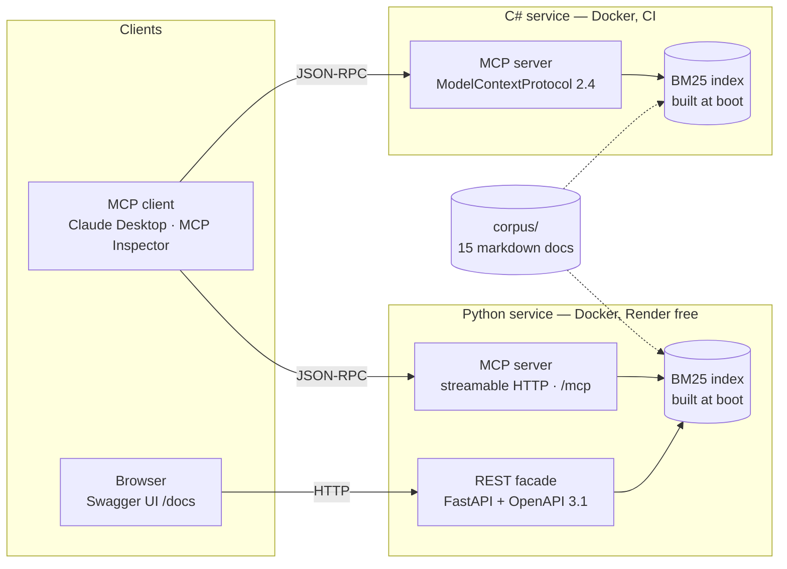

# mcp-rag-showcase

**One RAG contract. Two MCP servers. Same answers.**

A minimal, fully free reference implementation of a retrieval-augmented tool surface exposed through the
[Model Context Protocol](https://modelcontextprotocol.io) — written twice, in **C# (.NET 10)** and **Python 3.12**,
sharing one corpus and one frozen scoring spec, and proven equivalent by a conformance test.

No API keys. No paid models. No cloud spend. No vector database.

[](https://github.com/Steinantonio/mcp-rag-showcase/actions/workflows/ci.yml)


---

## What this repository actually proves

Most "MCP + RAG" demos are one language, one model call, and a screenshot. This one is built to be *checked*:

| Claim | Evidence |
|---|---|
| The MCP tool contract is language-agnostic | The same three tools, same JSON shapes, implemented independently in C# and Python |
| Retrieval is reproducible | BM25 with frozen parameters, no model, no randomness — byte-identical ranking on the same input |
| The two implementations agree | `tests/conformance` replays 10 golden queries against both servers and asserts the same `docId` sequence |
| It runs in a container | Two Dockerfiles, one `compose.yaml`, smoke-tested in CI |
| It is deployable for free | Live REST + OpenAPI surface on Render's free tier; `render.yaml` is in the repo |
| Infrastructure is code, not clicks | `infra/main.bicep` is validated on every push and **never deployed** (so it costs nothing) |

## Architecture



Both services are self-contained: same corpus, same tokenizer, same BM25 constants, no shared runtime and no
network hop between them. The duplication is the point — see [ADR 0002](docs/adr/0002-parity-contract.md).

## The contract (v1)

Three tools, identical in both servers. Full JSON Schemas, chunking rules and scoring constants live in
[`docs/tool-contract.md`](docs/tool-contract.md), which is the single source of truth for both implementations.

| Tool | Input | Output | Purpose |
|---|---|---|---|
| `search` | `query: string`, `k?: int = 5` | `chunks[]` with `docId`, `chunkId`, `score`, `text`, `citation` | Retrieval surface |
| `get_document` | `docId: string` | full markdown + metadata | Grounding, no truncation games |
| `answer` | `query: string`, `k?: int = 3` | `answer: string`, `citations[]`, `grounded: bool` | Extractive answer with citations |

`answer` is **extractive**: it selects sentences from retrieved chunks and cites them. There is no generator
model, so the output is reproducible and the demo never depends on a vendor. See
[ADR 0001](docs/adr/0001-lexical-retrieval.md).

## Live demo

| Surface | URL | Notes |
|---|---|---|
| Swagger UI | `https://mcp-rag-showcase.onrender.com/docs` | Free tier sleeps after 15 min idle — first request takes ~60 s |
| OpenAPI 3.1 | `https://mcp-rag-showcase.onrender.com/openapi.json` | Generated from the app, kept in sync by CI |
| MCP endpoint | `https://mcp-rag-showcase.onrender.com/mcp` | Streamable HTTP transport |
| Health | `https://mcp-rag-showcase.onrender.com/health` | Corpus stats + build info |

Quick pokes once it is awake:

```powershell
$svc = "https://mcp-rag-showcase.onrender.com"

curl.exe -s "$svc/health"

curl.exe -s "$svc/api/v1/search?q=rotate%20api%20key&k=3" | ConvertFrom-Json |
  Select-Object -ExpandProperty results | Format-Table chunkId, score, heading

Invoke-RestMethod -Method Post -Uri "$svc/api/v1/answer" -ContentType "application/json" `
  -Body (@{ query = "how do I rotate an api key"; k = 3 } | ConvertTo-Json)
```

## Run it locally

Requires .NET 10 SDK and Python 3.12. Docker is optional and only needed for the container path.

```powershell
git clone https://github.com/Steinantonio/mcp-rag-showcase.git
cd mcp-rag-showcase

./scripts/bootstrap.ps1   # creates .venv, installs deps, restores .NET
./scripts/test.ps1        # unit tests + cross-language conformance
./scripts/serve.ps1       # runs the Python service on http://localhost:8080
./scripts/up.ps1          # docker compose up: both servers (8080, 8081)
./scripts/smoke.ps1       # calls both servers, prints rankings side by side
```

`smoke.ps1` is the money shot — the same query against both servers, identical citations. Expected shape (the
verbatim transcript from a real run lands here at W4, see `docs/plan.md`):

```
query: how do I rotate an api key
  dotnet  ops-credentials#02  0.8421   python  ops-credentials#02  0.8421   MATCH
  dotnet  ops-runbook#04      0.5107   python  ops-runbook#04      0.5107   MATCH
  dotnet  ops-faq#01          0.4390   python  ops-faq#01          0.4390   MATCH
```

## Use it from an MCP client

```json
{
  "mcpServers": {
    "rag-dotnet": {
      "command": "dotnet",
      "args": ["run", "--project", "src/Mcp.Rag.Dotnet"]
    },
    "rag-python": {
      "command": ".venv/Scripts/python.exe",
      "args": ["-m", "mcp_rag_py", "--stdio"]
    }
  }
}
```

Both servers support stdio (for desktop clients) and streamable HTTP (for containers). Same tools either way.

## Layout

```
corpus/                    15 authored markdown docs + golden/queries.json
src/Mcp.Rag.Dotnet/        Core/ (tokenizer, chunker, BM25, engine) + Adapters/ (MCP tools)
src/mcp_rag_py/            core/ (pure) + adapters/ (REST, MCP, filesystem) + apps/ (CLI, root)
tests/conformance/         golden vectors replayed against both servers
tests/arch/                import-linter and NetArchTest boundaries
infra/                     Dockerfile x2, compose.yaml, main.bicep
scripts/                   bootstrap · test · serve · up · smoke · down · clean
specs/                     SDD: constitution, spec/plan/tasks per capability
agents/                    the six agent definitions and their conventions
templates/                 handoff, delegation brief, ADR, evidence log
docs/                      concepts, methodology, tool contract, ADRs, plan, OpenAPI
render.yaml                free-tier deployment of the Python service
```

## How it was built

The repository is spec-driven, and the process is an artifact too: `specs/` holds the constitution, the specs and the
task lists; `agents/` holds the six agent roles that built it; `docs/methodology.md` explains the loop, and
`docs/ai/` records what each agent produced, what was validated and what was rejected.

- **Mental model first:** [`docs/concepts.md`](docs/concepts.md) — four analogies and three diagrams.
- **Process:** [`docs/methodology.md`](docs/methodology.md) and [`AGENTS.md`](AGENTS.md).
- **What must be true, and in which order:** [`specs/README.md`](specs/README.md).

## Zero-cost by design

| Concern | Choice | Cost |
|---|---|---|
| CI | GitHub Actions on a public repo | $0 |
| Images | GHCR, public packages | $0 |
| Hosting | Render free web service (0.1 CPU / 512 MB, 750 h/mo) | $0 |
| Model / embeddings | none — BM25 + extractive answer | $0 |
| Vector DB | none — in-memory index over 15 documents | $0 |
| IaC | Bicep validated in CI, never applied | $0 |
| Secrets | none required to run or test | $0 |

The only thing this repo consumes is CI minutes and a free instance that sleeps when nobody is looking.

## Honest limitations

- **Lexical retrieval only.** No embeddings, so no synonym or paraphrase matching. "reset my password" will not
  find a document that only says "credential recovery". That is a documented trade-off, not an oversight.
- **Extractive answers.** The answer is stitched from source sentences, so it reads like a quote, not prose.
- **Cold start.** Render's free tier spins down after 15 minutes idle; the first request pays ~60 s.
- **Tiny corpus.** 15 documents. This demonstrates the shape of a pipeline, not retrieval quality.
- **No auth.** The corpus is authored for this repo and public on purpose. Adding auth would add a key to manage,
  which defeats the "clone and run" goal.
- **Index rebuilt at boot.** Render free has an ephemeral filesystem, so the index is in memory and rebuilt from
  `corpus/` on every start. At this size it takes milliseconds.

## Design decisions

| ADR | Decision |
|---|---|
| [0001](docs/adr/0001-lexical-retrieval.md) | Lexical BM25 retrieval and an extractive answer instead of embeddings + LLM |
| [0002](docs/adr/0002-parity-contract.md) | Freeze the scoring spec; prove parity with shared golden vectors |
| [0003](docs/adr/0003-http-surfaces-and-render.md) | MCP over streamable HTTP plus a REST/OpenAPI facade; host one free service |

## Not built on purpose

Reranking, hybrid search, streaming answers, auth, multi-tenancy, a vector store, an admin UI, and an eval harness
with recall@k. Each one is a real feature; none of them makes this demo more convincing per line of code.
The roadmap in [`docs/plan.md`](docs/plan.md) says what would come next and why it is deferred.

## License

MIT — see [LICENSE](LICENSE).
