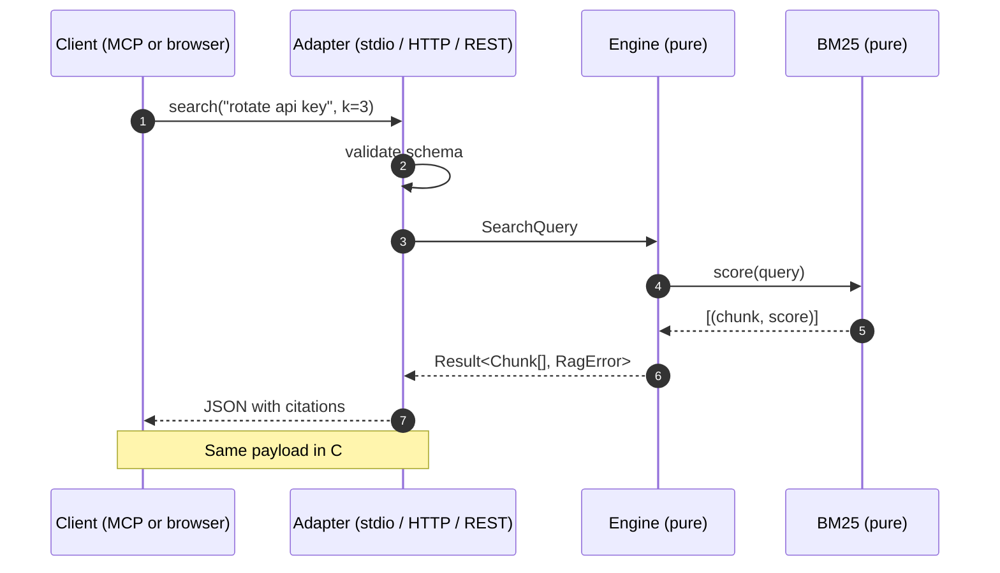
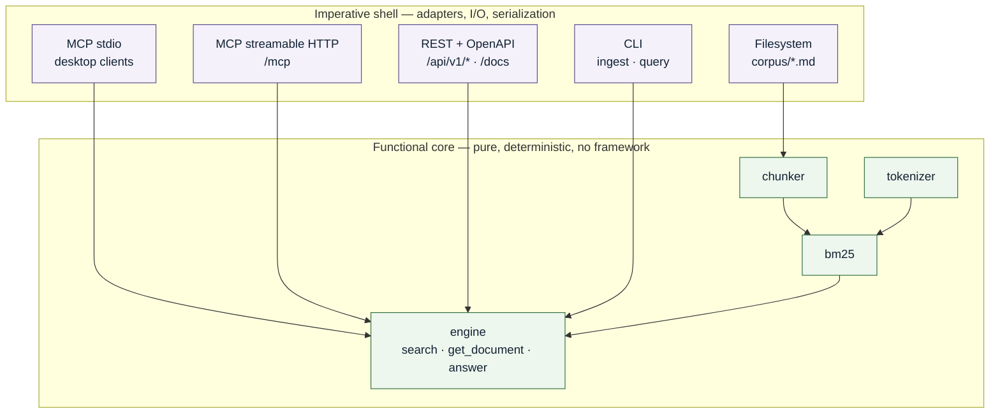
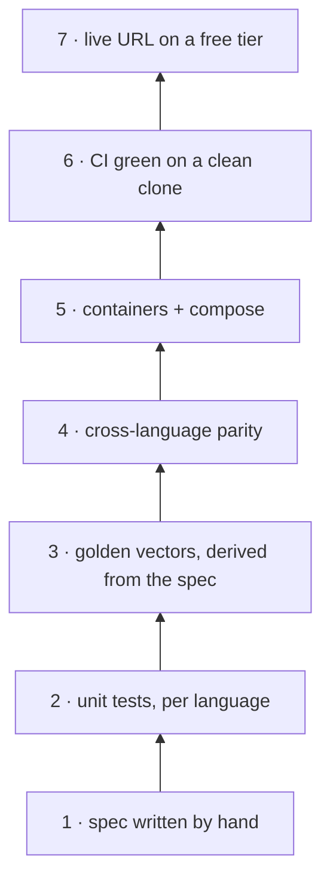

# Concepts — the mental model

Read this before the README if you want the idea rather than the file list.

## 1. The idea in one sentence

> A retrieval engine written twice, behind three doors, proven identical by a test that does not trust either
> implementation.

Everything else in this repo is a consequence of that sentence.

### Three analogies

**Two kitchens, one recipe.** The recipe is `docs/tool-contract.md`: grams, temperature, time. One kitchen is C#,
the other Python. The recipe does not say "cook until it looks right" — it says 1200-character chunks, `k1 = 1.2`,
`b = 0.75`. A food critic tastes both blindfolded and must not be able to tell which kitchen sent the plate. That
critic is the conformance test, and the plates are the golden vectors.

**One kitchen, two service windows.** A restaurant does not build a second kitchen for the drive-thru. MCP over
stdio, MCP over HTTP and the REST/OpenAPI facade are three windows onto the same kitchen. Hexagonal architecture is
just the floor plan that makes this true by construction instead of by discipline.

**A calibrated ruler.** BM25 scores only mean something relative to `N` (number of chunks) and `avgdl` (average
chunk length). Change the corpus and the ruler changes, so every previous measurement is void. That is why the
corpus freezes at W1 — not for tidiness, but because you cannot compare measurements taken with two different
rulers.

## 2. What this is, and what it is not

| This repository **is** | This repository is **not** |
|---|---|
| A protocol-parity proof: same contract, two stacks, same output | A chatbot |
| A reference for exposing a retrieval core through MCP | A RAG framework or a library |
| A demonstration of spec-first delivery with agents | A benchmark of retrieval quality |
| A zero-cost deployment story (free tier, no keys) | A production service |
| A small, auditable codebase (~2k LOC) | A scalable search engine |

## 3. The four actors

| Actor | What it is | Analogy | Failure if missing |
|---|---|---|---|
| **Corpus** | 15 authored markdown docs + golden vectors | the ingredients | nothing to retrieve; parity has no data to disagree about |
| **Core** | pure functions: tokenizer, chunker, BM25, engine | the recipe and the stove | logic leaks into HTTP/MCP layers and stops being portable |
| **Adapters** | MCP stdio, MCP HTTP, REST/OpenAPI, CLI, filesystem | the service windows | the core becomes untestable without a network |
| **Evidence** | golden vectors, CI jobs, ADRs, deploy transcript | the food critic | claims become adjectives |

## 4. How one question crosses the system

1. A client sends `search("rotate api key", k=3)` — via MCP tool call, REST GET, or CLI.
2. The **adapter** validates the argument shape and converts it to a core query object. No retrieval logic here.
3. The **tokenizer** applies the frozen rule: lowercase, split on `[^\p{L}\p{N}]+`, no stemming, no stopwords.
4. **BM25** scores every chunk; ordering is `score desc, docId asc, chunkId asc`; zero scores are dropped.
5. The **engine** returns a typed `Result` — chunks on success, a `RagError` code on failure. Never an exception
   that carries a stack trace across the boundary.
6. The **adapter** serializes the same payload the other adapters serialize. Same object, different envelope.
7. The client sees citations like `ops-credentials#02`, which is a stable handle into a specific chunk of a
   specific document.

## 5. Architecture as a floor plan

| Layer | Analogy | Rule that keeps it honest | Enforced by |
|---|---|---|---|
| Core | the kitchen | imports no framework, no HTTP, no MCP, no filesystem | `import-linter` (Python), `NetArchTest` (.NET) |
| Adapters | the service windows | translate, never decide | code review + architecture test |
| Composition root | the maître d' | wiring happens in one file | review |
| Corpus | the pantry | read-only at runtime | mount read-only in compose |

## 6. The ladder of proof

Each rung removes one way of being wrong. No rung is skipped because the one below it passed.

| Rung | Discards this failure mode |
|---|---|
| Spec | "we built something, nobody agreed what" |
| Unit tests | "the algorithm is broken in one language" |
| Golden vectors | "both implementations agree with each other's bug" |
| Parity | "C# and Python quietly tokenize differently" |
| Containers | "works on the author's machine, not in a box" |
| CI | "the demo depends on uncommitted local state" |
| Live URL | "the deployment story is a paragraph, not a fact" |

## 7. Numbers

| Thing | Count | Why that number |
|---|---|---|
| MCP tools | 3 | retrieval, grounding, answer — the minimum useful surface |
| Servers | 2 | one per language; that is the entire point |
| Documents in corpus | 15 | enough for IDF to matter, small enough to audit by hand |
| Golden queries | 10 | covers hits, misses, ties and repeated tokens |
| HTTP surfaces | 3 | stdio, streamable HTTP, REST |
| CI jobs | 5 | python, dotnet, containers, IaC, contract |
| Required secrets | 0 | clone and run |
| Monthly cost | 0 | free tier + public repo |

## 8. What breaks if you touch X

This table is the fastest way to feel why the spec is frozen.

| If you change… | Then… | Because |
|---|---|---|
| a document in `corpus/` | every score shifts | `N` and `avgdl` are global |
| `k1` or `b` | ranking order changes, tests fail | they are contract, not tuning knobs |
| the tokenizer regex | all golden vectors are invalid | tokenization defines term boundaries |
| chunk size 1200 | every `chunkId` can change | chunk boundaries move |
| tie-break order | equal scores swap places | ordering must be total and deterministic |
| the `answer` sentence rule | citations can change | citation order follows sentence order |

## 9. Three reading paths

| Time | Read | You will know |
|---|---|---|
| 60 s | README §"What this proves" + the mermaid diagram | what the repo claims |
| 5 min | this file + `docs/tool-contract.md` §3–5 | whether the claim is checkable |
| 30 min | ADR 0001–0003 + `specs/constitution.md` | why the trade-offs are the right ones |

## 10. What this does not prove

- That lexical retrieval is *good*. It is deterministic and auditable; that is a different virtue.
- That the design scales past ~5k tokens. Brute-force scoring is a deliberate ceiling.
- That the deployment is production-grade. No auth, no persistence, no SLOs.
- That two languages are always worth it. Here they are the artifact being demonstrated, not a recommendation.
